<div align="center">

# 🔥 Winter Stove

**Meta Quest VR 힐링 미니게임 · 팀 프로젝트**

*겨울 오두막에서 다트 · 화이트보드 · 젠가 · 고양이와 노는, **손으로 직접 잡고 · 던지고 · 그리는 VR***

[](https://unity.com/)
[](#)
[](#)
[](#)

[▶ 포트폴리오 영상 (YouTube)](https://www.youtube.com/watch?v=d2nPrdX7Xqs) · [🌐 포트폴리오 사이트](https://chlwnsdud2025.github.io/projects/winter-stove.html)

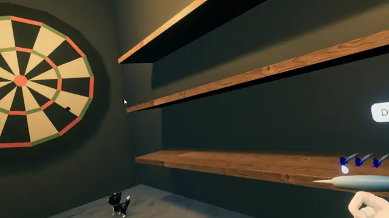 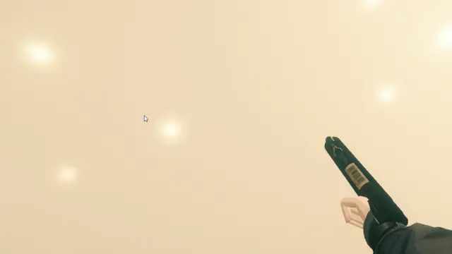

<sub>왼쪽: 다트를 던지면 자체 CCD로 과녁을 통과하지 않고 꽂힘 · 오른쪽: 화이트보드에 그린 삼각형을 $1 Recognizer로 판정</sub>

</div>

<br>

## 📌 프로젝트 개요

| 항목 | 내용 |
| --- | --- |
| **장르** | VR 힐링 미니게임 (1인칭 · 손 상호작용) |
| **개발 형태** | 팀 프로젝트 (3인) |
| **개발 기간** | 2026.06.05 – 2026.06.21 |
| **플랫폼** | Meta Quest (OpenXR) |
| **개발 환경** | Unity 6 (6000.4.5f1), C#, URP, XR Interaction Toolkit 3.4 |
| **맡은 역할** | **VR 상호작용 오브젝트 11종 · 그림 제스처 인식 · 고양이 AI** |
| **핵심 기술** | 자체 CCD (Raycast 선판정) · $1 Unistroke Recognizer 확장 · FSM + NavMesh |

<br>

## 🎮 게임 소개

> 겨울 오두막에서 손에 닿는 물건으로 놀며 쉬는 Meta Quest VR 미니게임입니다.
> 다트 · 화이트보드 · 젠가 · 카드 · 설거지 · 술 · TV · 쓰레기 던지기 · 샌드백 · 총 · 고양이까지, 모든 상호작용을 버튼이 아니라 **잡고 · 던지고 · 기울이고 · 그리는 손동작**으로 판정합니다.

퀘스트 패널의 도전 과제(다트 중앙 맞추기, 삼각형 그리기, 샌드백 1000점 등)를 오브젝트를 직접 다루며 하나씩 달성합니다.

<br>

## 🙋 담당 구현 요약

| # | 구현 내용 | 핵심 키워드 |
| :-: | --- | --- |
| 1 | [다트 — 고속 투척 관통을 막는 자체 CCD](#1-다트--고속-투척-관통을-막는-자체-ccd) | 속도 기반 Raycast 선판정 · 다트 끝 위치 보정 · 1cm 중앙 판정 |
| 2 | [화이트보드 — $1 Recognizer 확장](#2-화이트보드--1-recognizer-확장) | 64점 리샘플링 · 시작점 8개 × 정 / 역방향 · 황금분할 회전 탐색 |
| 3 | [고양이 — FSM + NavMesh AI](#3-고양이--fsm--navmesh-ai) | 8개 State · 확률 기반 자율 행동 · XR Hover / Select 이벤트 전환 |
| 4 | [VR 상호작용 오브젝트 8종](#4-vr-상호작용-오브젝트-8종) | 젠가 · 카드 · 설거지 · 술 · TV · 쓰레기 · 샌드백 · 총 |
| 🔗 | [퀘스트 시스템 연결](#-퀘스트-시스템-연결) | ConditionData · VoidEventChannel로 판정 결과 전달 |

---

## 1. 다트 — 고속 투척 관통을 막는 자체 CCD

> **빠르게 던진 다트가 물리 스텝 사이에 과녁을 지나치던 문제를, 다음 이동 구간을 미리 Raycast로 검사해 해결**

<p align="center">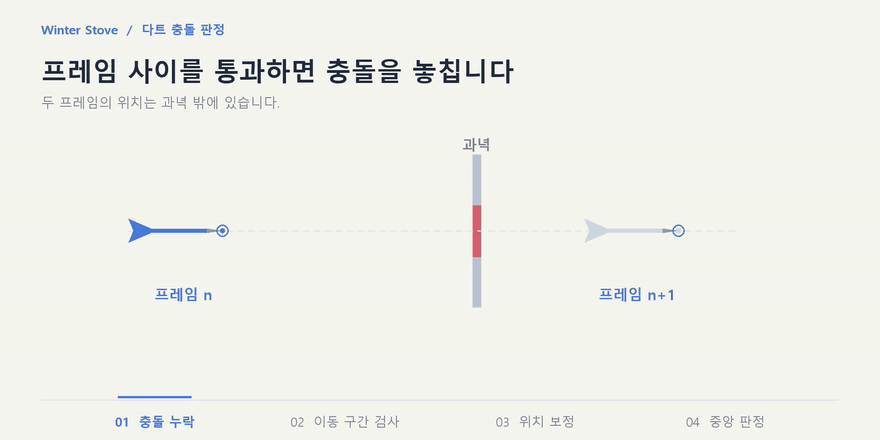</p>

#### 🔍 문제 상황
VR에서 손으로 던진 다트는 한 번의 FixedUpdate 동안 이동하는 거리가 과녁 두께보다 커서, **두 물리 스텝 사이에 과녁을 지나쳐 충돌이 누락**되었습니다.

#### 🛠 해결

| 해결 포인트 | 내용 |
| --- | --- |
| **이동 구간 선검사** | 날아가는 동안 매 FixedUpdate마다 다트 끝(`dartTip`)에서 진행 방향으로 `속도 × fixedDeltaTime + 여유 거리`만큼 Raycast → 다음 스텝에 지나갈 구간의 과녁을 미리 찾음 |
| **꽂힌 위치 보정** | 과녁에 맞으면 `hit.point − dartTip.position`만큼 다트 전체를 옮겨 끝이 표면에 정확히 닿게 한 뒤, Rigidbody를 Kinematic으로 고정 |
| **비행 자세 보정** | 비행 중 `transform.forward`를 속도 방향에 맞춰, Raycast 방향과 다트 앞부분이 항상 진행 방향을 향하도록 유지 |
| **중앙 판정** | 고정 직후 다트 끝 반경 1cm `OverlapSphere`로 `DartMiddle` 영역을 검사해 중앙 명중 이벤트 발생 |

```csharp
// DartBehavior.cs — 다음 물리 스텝에 이동할 구간을 미리 검사
void FixedUpdate()
{
    if (isFlying && !isStuck)
    {
        Vector3 rayOrigin = dartTip.position;
        float rayDistance = rb.linearVelocity.magnitude * Time.fixedDeltaTime + raycastrength;

        if (Physics.Raycast(rayOrigin, transform.forward, out RaycastHit hit, rayDistance))
        {
            if (hit.collider.CompareTag("DartBoard") || hit.collider.CompareTag("DartMiddle"))
            {
                transform.position += (hit.point - dartTip.position);  // 다트 끝을 과녁 표면에 맞춤
                StickToBoard();                                         // Kinematic 고정 → 중앙 판정
                return;
            }
        }

        if (rb.linearVelocity.sqrMagnitude > 0.1f)
            transform.forward = rb.linearVelocity.normalized;      // 비행 자세 보정
    }
}
```

#### ✅ 결과
- **판정** — 빠르게 던져도 과녁을 통과하지 않고, 다트 끝이 실제로 닿은 위치에 꽂힘
- **정확도** — 위치를 보정한 뒤 중앙 판정을 하므로, 다트 끝이 중앙 영역에 닿았는지를 그대로 판정
- **상호작용** — `XRGrabInteractable`의 놓기(`selectExited`)로 비행을 시작하고, 꽂힌 다트를 다시 잡으면(`selectEntered`) 상태를 초기화

📂 **관련 코드** — [`DartBehavior.cs`](Assets/_Scripts/InteractionScript/DartBehavior.cs)

---

## 2. 화이트보드 — $1 Recognizer 확장

> **펜으로 그린 궤적을 2D 점열로 바꾸고, 시작점과 그리는 방향이 달라도 같은 도형으로 인식하도록 $1 알고리즘을 확장**

### 2-1. VR 드로잉 입력

| 설계 | 내용 |
| --- | --- |
| **펜촉 판정** | 펜촉 10cm 뒤에서 보드 방향으로 Raycast. 손에 물리 저항이 없는 VR에서 펜촉이 보드를 파고들어도 표면을 놓치지 않음 |
| **선 그리기** | 펜촉이 보드에 가까워지면 획 시작, 5mm 이상 움직일 때만 `LineRenderer`에 점 추가 |
| **획 종료 · 2D 변환** | 펜을 떼면 한 획 종료 → 점 10개 이하는 노이즈로 무시 → 월드 좌표를 펜 기준 로컬 좌표로 바꿔 깊이(Z)를 버리고 2D 점열로 인식기에 전달 |

### 2-2. 시작점 · 방향에 흔들리지 않는 인식

#### 🔍 문제 상황
원본 $1 알고리즘은 **첫 점을 기준으로 회전을 정규화**하고 점을 순서대로 비교합니다. 그래서 같은 삼각형이라도 다른 꼭짓점에서 시작하거나 반대 방향으로 그리면 점 순서가 템플릿과 어긋나 점수가 크게 떨어졌습니다.

<p align="center">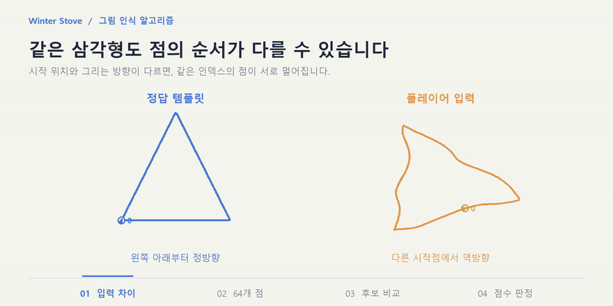</p>

#### 🛠 해결 — 인식 파이프라인

| 단계 | 처리 |
| --- | --- |
| **1. Resample** | 획 전체 길이를 63등분해 입력 길이와 상관없이 점 64개로 통일 |
| **2. 후보 생성** | 점열을 0 · 8 · 16 … 56칸 순환(시작점 8개) × 정방향 / 역방향 = **후보 16개** |
| **3. 정규화** | 각 후보를 RotateToZero(첫 점 각도 0°) → 250 × 250 영역으로 ScaleToSquare → 중심을 원점으로 이동 |
| **4. 회전 탐색** | 템플릿과 ±45° 범위에서 **황금분할 탐색**(2° 정밀도)으로 점 사이 평균 거리가 최소인 각도 탐색 |
| **5. 점수화** | `score = 1 − 최소 평균 거리 / (½ × 250√2)` → 씬에 설정한 기준 **0.92 이상**이면 성공 |

```csharp
// DollarRecognizer.cs — 시작점 8개 × 정 / 역방향 후보 중 가장 가까운 것을 선택
for (int step = 0; step < targetPointCount; step += shiftStep)     // 시작점 0, 8, 16 … 56
{
    // 정방향: 배열 순환 → 회전 · 크기 · 위치 정규화
    List<Point> shiftedForward = ShiftArray(forwardPoints, step);
    shiftedForward = RotateToZero(shiftedForward);
    shiftedForward = ScaleToSquare(shiftedForward, boxSize);
    shiftedForward = TranslateToOrigin(shiftedForward);

    // 역방향도 같은 과정 (생략)

    for (int i = 0; i < templates.Count; i++)
    {
        float distanceForward  = DistanceAtBestAngle(shiftedForward,  templates[i], -45f, 45f, 2f);
        float distanceBackward = DistanceAtBestAngle(shiftedBackward, templates[i], -45f, 45f, 2f);

        float minDistance = Mathf.Min(distanceForward, distanceBackward);
        if (minDistance < bestDistance)
        {
            bestDistance = minDistance;
            bestTemplateIndex = i;
        }
    }
}

// 0~1 점수 (1에 가까울수록 일치)
float halfDiagonal = 0.5f * Mathf.Sqrt(boxSize * boxSize + boxSize * boxSize);
float score = 1f - (bestDistance / halfDiagonal);
```

<p align="center">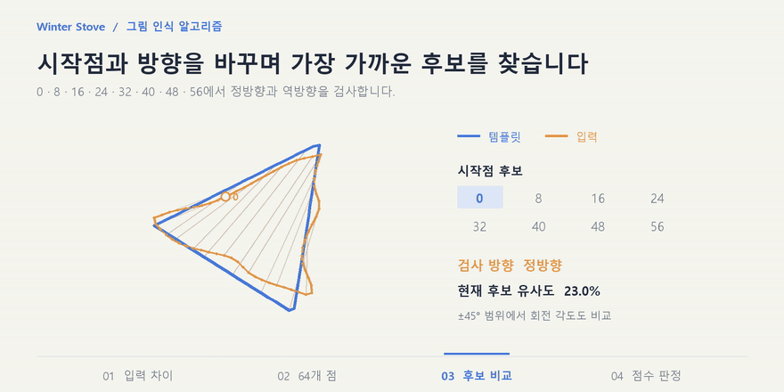</p>

#### ✅ 결과
- **입력 자유도** — 어느 꼭짓점에서 시작하든, 어느 방향으로 그리든 **삼각형 템플릿 1개**로 판정
- **판정 기준** — 영상의 예시 입력 기준 삼각형 93.7% · 원 81.5%로, 0.92 기준에서 두 도형을 구분 <sub>(설명용 입력을 실제 판정 코드로 계산한 값이며 인식률 통계가 아닙니다)</sub>
- **연결** — 성공하면 이벤트 채널로 알리고 "삼각형을 그리세요!" 퀘스트 조건을 달성 처리 · 리셋 버튼으로 보드의 선 전체 삭제

📂 **관련 코드** — [`DollarRecognizer.cs`](Assets/_Scripts/InteractionManager/DollarRecognizer.cs) · [`VRMarker.cs`](Assets/_Scripts/InteractionScript/VRMarker.cs) · [`VRDrawingReset.cs`](Assets/_Scripts/InteractionManager/VRDrawingReset.cs)

---

## 3. 고양이 — FSM + NavMesh AI

> **자율 행동은 상태 클래스로 나누고, 쓰다듬기 · 들기 같은 손 입력은 XR 이벤트로 어느 상태에서든 즉시 전환**

<p align="center">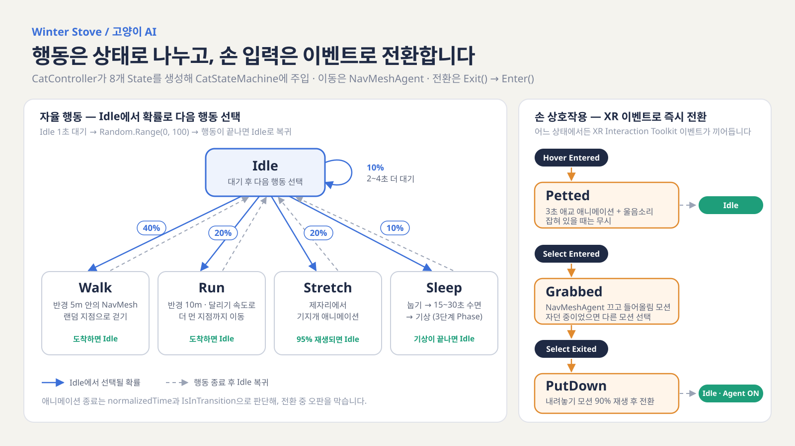</p>

<p align="center">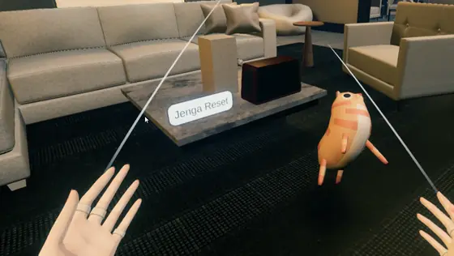</p>

| 설계 | 내용 |
| --- | --- |
| **상태 클래스 분리** | `CatBaseState`(Enter · Update · Exit)를 상속한 8개 State. `CatStateMachine.ChangeState`가 항상 Exit → Enter 순서로 전환 |
| **확률 기반 자율 행동** | Idle 1초 후 Walk 40% · Run 20% · Stretch 20% · Sleep 10% · 대기 연장 10%. Walk · Run은 `NavMesh.SamplePosition`으로 이동 가능한 지점만 목적지로 사용 |
| **XR 이벤트 전환** | Hover Entered → Petted, Select Entered → Grabbed(NavMeshAgent 비활성화), Select Exited → PutDown → Idle(Agent 재활성화) |
| **애니메이션 종료 판정** | `normalizedTime`과 `IsInTransition`을 함께 확인해 전환 중 오판 방지. 수면은 눕기 → 15~30초 수면 → 기상 3단계 Phase |
| **상태 기억** | 잡히기 직전 수면 여부(`wasSleepingBeforeGrab`)를 기억해 들어올림 · 내려놓기 모션을 다르게 재생 |

```csharp
// CatController.cs — XR Interactable 이벤트에 연결된 진입점
public void OnHoverEntered()          // 손이 닿으면 애교
{
    if (stateMachine.CurrentState != grabbedState)
        stateMachine.ChangeState(pettedState);
}

public void OnGrabEntered()           // 들어 올리면, 자던 중이었는지 기억
{
    wasSleepingBeforeGrab = (stateMachine.CurrentState == sleepState);
    stateMachine.ChangeState(grabbedState);
}

public void OnGrabExited() => stateMachine.ChangeState(putDownState);
```

📂 **관련 코드** — [`CatController.cs`](Assets/_Scripts/InteractionManager/Cat/CatController.cs) · [`CatStateMachine.cs`](Assets/_Scripts/InteractionManager/Cat/CatStateMachine.cs) · [`CatBaseState.cs`](Assets/_Scripts/InteractionManager/Cat/CatBaseState.cs) · [`State/`](Assets/_Scripts/InteractionManager/Cat/State)

---

## 4. VR 상호작용 오브젝트 8종

> **각 오브젝트의 '성공'을 버튼이 아닌 물리 · 각도 · 거리 · 시간 조건으로 판정**

<table>
<tr>
<td width="50%">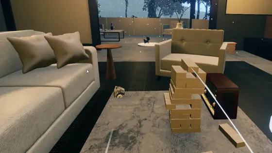</td>
<td width="50%">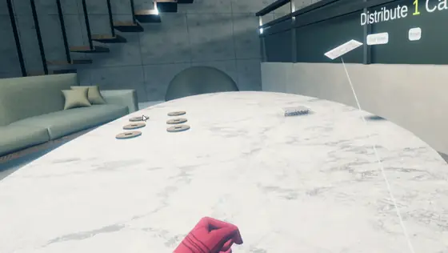</td>
</tr>
<tr>
<td align="center"><sub>🧱 젠가 — 블록 추출 성공 · 붕괴 실패 · 리셋</sub></td>
<td align="center"><sub>🃏 카드 — 셔플 · 테이블 중앙 정렬 분배</sub></td>
</tr>
<tr>
<td width="50%">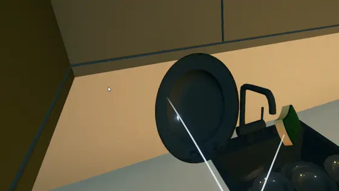</td>
<td width="50%">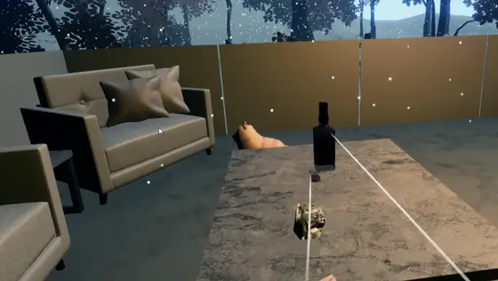</td>
</tr>
<tr>
<td align="center"><sub>🍽 설거지 — 문지른 시간 누적 · 건조대 집계</sub></td>
<td align="center"><sub>🍶 술 — 기울여 따르기 · 마시기 · 취기 효과</sub></td>
</tr>
<tr>
<td width="50%">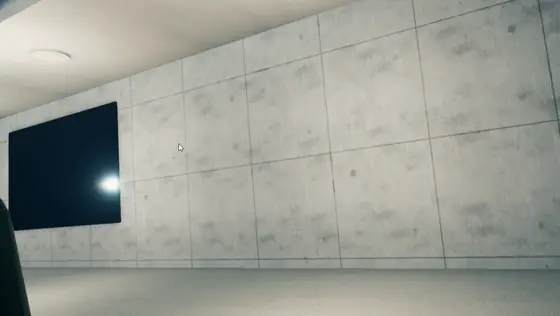</td>
<td width="50%">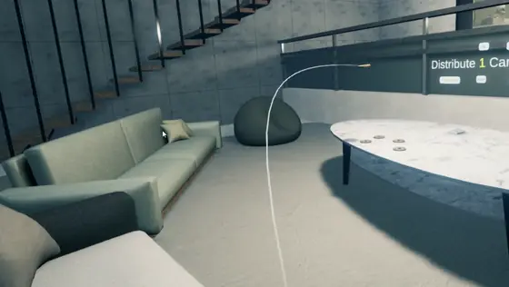</td>
</tr>
<tr>
<td align="center"><sub>📺 TV — 리모컨 Raycast로 전원 토글</sub></td>
<td align="center"><sub>🗑 쓰레기 — 투척 거리 · 정지 후 판정</sub></td>
</tr>
<tr>
<td width="50%">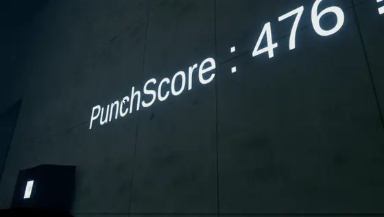</td>
<td width="50%">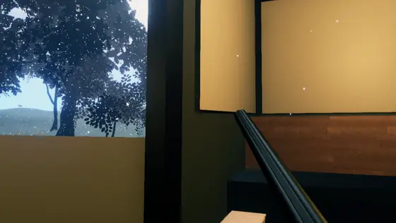</td>
</tr>
<tr>
<td align="center"><sub>🥊 샌드백 — 충돌 상대 속도로 점수</sub></td>
<td align="center"><sub>🔫 총 — 트리거 입력으로 발사 효과</sub></td>
</tr>
</table>

| 오브젝트 | 판정 방식 | 구현 포인트 |
| --- | --- | --- |
| 🧱 **젠가** | 블록이 타워 영역(트리거)을 완전히 벗어나면 성공 카운트, 실패 영역에 블록이 닿으면 게임 오버 | `OnTriggerExit`로 추출 판정 · 목표 개수 달성 시 이벤트 · 리셋 시 블록 상태와 카운트 초기화 |
| 🃏 **카드** | Fisher–Yates 셔플 후 `N장 × M묶음` 분배 | 묶음 전체 폭을 계산해 테이블 중앙 기준으로 정렬 · 원본 덱 목록을 백업해 분배한 카드 회수 |
| 🍽 **설거지** | 수세미와 닿아 있는 시간을 누적해 2초가 되면 세척 완료 → 머티리얼 교체 | 건조대 소켓의 Select 이벤트로 접시 수 집계(꺼내면 감소) → 5개가 되면 미션 완료 |
| 🍶 **술** | 병 기울기 90° 이상이면 액체 파티클, 파티클이 잔에 닿으면 채워짐 | 따르기 판정에 5° 여유 각도를 둬 경계에서 깜빡임 방지 · 잔 기울기 90° 이상 + 얼굴 25cm 이내면 마심 · 3잔이면 URP Volume(렌즈 왜곡 · 색수차)으로 10초 취기 |
| 📺 **TV** | 리모컨 트리거(Activate) 입력 시 앞쪽으로 15m Raycast | 맞은 오브젝트에서 `TVController`를 찾아 전원 토글 · 화면 표시와 VideoPlayer 재생 제어 |
| 🗑 **쓰레기** | 던진 순간의 위치를 저장하고, 1초 이상 완전히 멈추면 판정 | 휴지통 영역 안에 멈췄고 던진 거리가 기준 이상이면 성공 · 다시 잡으면 판정 초기화 |
| 🥊 **샌드백** | 글러브 충돌의 상대 속도 × 100 = 점수 | 최소 충격 기준 · 0.5초 재판정 대기로 중복 판정 방지 · 1000점 이상이면 이벤트 |
| 🔫 **총** | 잡은 총의 트리거(Activate) 입력으로 발사 | 총구 위치에 머즐 플래시 생성 후 0.5초 뒤 제거 · 발사음 · 이벤트 |

📂 **관련 코드** — [`JengaManager.cs`](Assets/_Scripts/InteractionManager/JengaManager.cs) · [`JengaBlock.cs`](Assets/_Scripts/InteractionScript/JengaBlock.cs) · [`CardDeckManager.cs`](Assets/_Scripts/InteractionManager/CardDeckManager.cs) · [`SinkManager.cs`](Assets/_Scripts/InteractionManager/SinkManager.cs) · [`DishBehavior.cs`](Assets/_Scripts/InteractionScript/DishBehavior.cs) · [`BottleBehavior.cs`](Assets/_Scripts/InteractionScript/BottleBehavior.cs) · [`SimpleCupBehavior.cs`](Assets/_Scripts/InteractionScript/SimpleCupBehavior.cs) · [`DrunkEffectController.cs`](Assets/_Scripts/InteractionScript/DrunkEffectController.cs) · [`RemoteController.cs`](Assets/_Scripts/InteractionScript/RemoteController.cs) · [`TVController.cs`](Assets/_Scripts/InteractionScript/TVController.cs) · [`TrashItem.cs`](Assets/_Scripts/InteractionScript/TrashItem.cs) · [`PunchingBag.cs`](Assets/_Scripts/InteractionScript/PunchingBag.cs) · [`GunBehavior.cs`](Assets/_Scripts/InteractionScript/GunBehavior.cs)

---

## 🔗 퀘스트 시스템 연결

> **각 오브젝트는 판정 결과만 알리고, 퀘스트 진행은 팀원이 설계한 ScriptableObject 기반 조건 · 이벤트 채널이 담당**

<table>
<tr>
<td width="45%">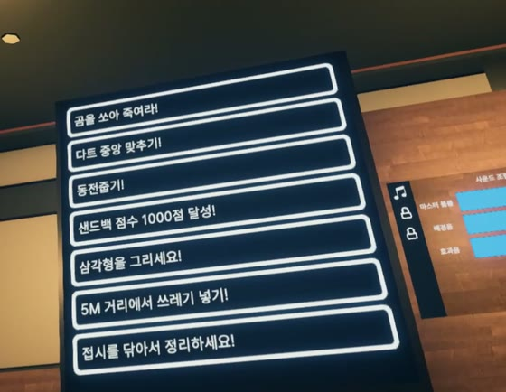</td>
<td>

| 퀘스트 | 연결한 판정 |
| --- | --- |
| 다트 중앙 맞추기 | 다트 끝 중앙 영역 판정 |
| 삼각형을 그리세요 | $1 유사도 0.92 이상 |
| 샌드백 점수 1000점 | 충돌 점수 1000 이상 |
| 쓰레기 넣기 | 투척 거리 · 정지 판정 |
| 접시를 닦아서 정리 | 건조대 접시 5개 |
| 젠가 성공 | 목표 추출 개수 달성 |

</td>
</tr>
</table>

- 판정이 끝나면 `ConditionData.achived = true`로 조건을 기록하고 `VoidEventChannel.RaiseEvent()`로 알림
- 퀘스트(`QuestData`)와 사이클 이벤트는 `ConditionData`를 완료 · 발생 조건으로 참조하므로, **오브젝트 스크립트는 퀘스트 구현을 몰라도 됨**

---

## 🧰 기술 스택

| 분류 | 사용 기술 |
| --- | --- |
| **Engine** | Unity 6 (6000.4.5f1), URP |
| **Language** | C# |
| **XR** | XR Interaction Toolkit 3.4, OpenXR (Meta Quest) |
| **AI / Navigation** | FSM, NavMesh (AI Navigation) |
| **Rendering** | URP Volume (Lens Distortion · Chromatic Aberration), LineRenderer, VideoPlayer |
| **Collaboration** | Git, GitHub |

> 게임 공간 · 캐릭터 · 오브젝트 모델과 공통 시스템(퀘스트 · 사운드 · 이벤트 채널 · 리셋)은 팀원 구현과 외부 에셋을 사용했습니다.
> `main`은 Meta Quest 빌드 브랜치(`Meta-Build`) 기준의 최종 상태입니다.

<br>

<div align="center">

**최준영 · Unity Client Developer**
📧 juny2221@gmail.com · ▶ [YouTube](https://www.youtube.com/channel/UCMoIuWbEUPRG-8-CIZpd6cQ)

</div>
