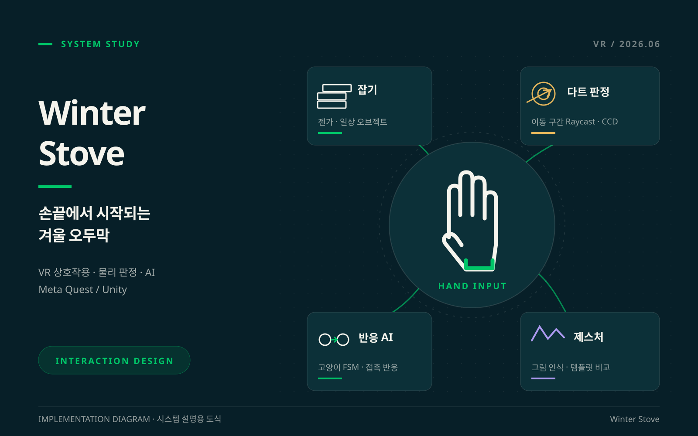
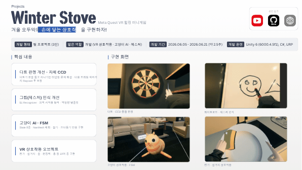

<div align="center">

# 🔥 Winter Stove

**Meta Quest VR 힐링 미니게임 · 팀 프로젝트**

*겨울 오두막에서 손에 닿는 물건과 고양이를 다루는 **손끝으로 만드는 VR의 일상***

[](https://unity.com/)
[](#)
[](#)
[](#)

[🌐 포트폴리오 사이트](https://chlwnsdud2025.github.io/projects/winter-stove.html) · [📑 원본 프로젝트 포트폴리오](https://www.canva.com/d/mzu8Fvwvj8IVG7d)



</div>

<br>

## 📌 프로젝트 개요

| 항목 | 내용 |
| --- | --- |
| **장르** | VR 힐링 미니게임 |
| **개발 형태** | 팀 프로젝트 (3인) |
| **개발 기간** | 2026.06.05 – 2026.06.21 |
| **플랫폼** | Meta Quest |
| **개발 환경** | Unity 6 (6000.4.5f1), C#, URP, XR Interaction Toolkit, OpenXR (Meta) |
| **맡은 역할** | **VR 상호작용 · 고양이 AI · 제스처** |

<br>

## 🎮 게임 소개

> 겨울 오두막에서 손에 닿는 물건과 고양이를 다루는 VR 미니게임입니다.
> 젠가 · 설거지 · 다트 · 펀칭백 같은 일상적인 놀이와, 손으로 그린 그림을 인식하는 제스처를 구현했습니다.

<br>

## 🙋 담당 구현 요약

| # | 구현 내용 | 핵심 키워드 |
| :-: | --- | --- |
| 1 | [다트 터널링을 보완한 자체 CCD](#1-다트-터널링을-보완한-자체-ccd) | 다음 프레임 예상 위치까지 Raycast · 충돌 시 위치 보정 |
| 2 | [그림 제스처 인식 개선](#2-그림-제스처-인식-개선) | $1 Recognizer · 최적 시작점 탐색 · 역방향 템플릿 |
| 3 | [고양이의 상태와 반응](#3-고양이의-상태와-반응) | 8종 State FSM · NavMesh 배회 · 잡기 / 쓰다듬기 반응 |
| 4 | [손으로 다루는 VR 오브젝트](#4-손으로-다루는-vr-오브젝트) | 젠가 · 설거지 · 술 · 펀칭백 · 총 등 10여 종 |

---

## 1. 다트 터널링을 보완한 자체 CCD

| 단계 | 내용 |
| --- | --- |
| **문제** | 빠른 다트가 프레임 사이에 다트판을 관통했습니다. |
| **구현** | 다음 프레임의 예상 위치까지 Raycast를 수행하고, 충돌 시 다트 끝을 다트판 표면에 맞춰 위치를 보정했습니다. |
| **결과** | 다트의 고속 이동에서 빠지던 판정을 보완했습니다. |

```
현재 위치  →  다음 프레임 예상 위치  →  Raycast 충돌 검사  →  다트 위치 보정
```

📂 **관련 코드** — [`DartBehavior.cs`](Assets/_Scripts/InteractionScript/DartBehavior.cs)

---

## 2. 그림 제스처 인식 개선

| 단계 | 내용 |
| --- | --- |
| **문제** | 같은 도형도 시작점과 그리는 방향에 따라 인식이 달라졌습니다. |
| **구현** | $1 Recognizer에 최적 시작점 탐색과 역방향 템플릿을 적용했습니다. |
| **결과** | 입력 순서 차이를 고려하는 제스처 인식을 구성했습니다. |

```
입력 궤적  →  시작점 탐색  →  정 · 역방향 템플릿  →  제스처 선택
```

📂 **관련 코드** — [`DollarRecognizer.cs`](Assets/_Scripts/InteractionManager/DollarRecognizer.cs) · [`VRMarker.cs`](Assets/_Scripts/InteractionScript/VRMarker.cs)

---

## 3. 고양이의 상태와 반응

| 단계 | 내용 |
| --- | --- |
| **문제** | 배회와 잡기 · 쓰다듬기 입력의 반응을 분리해야 했습니다. |
| **구현** | 8종 State의 FSM과 NavMesh 배회를 구현했습니다. |
| **결과** | 잡기 · 쓰다듬기에 반응하는 고양이 AI를 구성했습니다. |

```
배회  →  잡기 · 쓰다듬기  →  상태 전환  →  반응 애니메이션
```

**State** — Idle · Walk · Run · Sleep · Stretch · Grabbed · PutDown · Petted

📂 **관련 코드** — [`CatController.cs`](Assets/_Scripts/InteractionManager/Cat/CatController.cs) · [`CatStateMachine.cs`](Assets/_Scripts/InteractionManager/Cat/CatStateMachine.cs) · [`State/`](Assets/_Scripts/InteractionManager/Cat/State)

---

## 4. 손으로 다루는 VR 오브젝트

| 단계 | 내용 |
| --- | --- |
| **문제** | 각 물건의 규칙에 맞는 직접 조작이 필요했습니다. |
| **구현** | 젠가 · 설거지 · 술 · 펀칭백 · 총 등 10여 종 상호작용 오브젝트를 구현했습니다. |
| **결과** | 여러 놀이가 한 오두막의 직접 조작 경험으로 이어지도록 구성했습니다. |

```
손 입력  →  잡기 · 놓기  →  오브젝트 규칙  →  VR 피드백
```

📂 **관련 코드** — [`JengaManager.cs`](Assets/_Scripts/InteractionManager/JengaManager.cs) · [`SinkManager.cs`](Assets/_Scripts/InteractionManager/SinkManager.cs) · [`BottleBehavior.cs`](Assets/_Scripts/InteractionScript/BottleBehavior.cs) · [`PunchingBag.cs`](Assets/_Scripts/InteractionScript/PunchingBag.cs) · [`GunBehavior.cs`](Assets/_Scripts/InteractionScript/GunBehavior.cs) · [`InteractionScript/`](Assets/_Scripts/InteractionScript)

<details>
<summary>📑 원본 프로젝트 포트폴리오 보기</summary>
<br>
<a href="https://www.canva.com/d/mzu8Fvwvj8IVG7d"></a>
</details>

---

## 🧰 기술 스택

| 분류 | 사용 기술 |
| --- | --- |
| **Engine** | Unity 6 (6000.4.5f1), URP |
| **Language** | C# |
| **XR** | XR Interaction Toolkit, OpenXR (Meta Quest) |
| **AI / Navigation** | FSM, NavMesh (AI Navigation) |
| **Collaboration** | Git, GitHub |

> `main`은 Meta Quest 빌드 브랜치(`Meta-Build`) 기준의 최종 상태입니다.

<br>

<div align="center">

**최준영 · Unity Client Developer**
📧 juny2221@gmail.com · ▶ [YouTube](https://www.youtube.com/channel/UCMoIuWbEUPRG-8-CIZpd6cQ)

</div>
